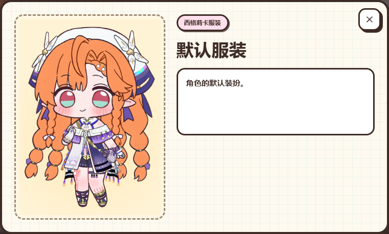
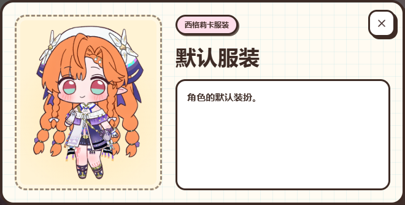

# 桌面服装详情留白调整

沿用现有手绘风格，缩窄双栏窗口、限制立绘展示高度。根据后续反馈，右侧改为与左侧图框上下对齐，介绍框填满标题下方剩余高度，长介绍在框内滚动，关闭按钮位置保持。

真实 HouseModal 链路下的默认服装测量：

| 视口 | 原窗口 | 调整后 |
| --- | --- | --- |
| 1440 × 900 | 760 × 458 | 660 × 334 |
| 1440 × 768 | 760 × 400 | 660 × 334 |
| 1024 × 600 | 760 × 326 | 660 × 334 |
| 390 × 844 | 368 × 594 | 368 × 594，保持一致 |

最终默认短介绍框在 1440px 桌面为 181px 高，右侧与 286px 图框上下齐平；窗口仍为 660×334px。1024px 桌面同样对齐，390px 手机尺寸保持一致。最终截图为 aligned-*.png，aligned.json 保存四组测量。图像继续通过 PortraitShowcase 完整展示；没有调整资源、文字、画师信息或业务行为。截图使用本地目录中的角色数据，线上配置有画师署名时继续在标题下显示。

| 修改前 | 修改后 |
| --- | --- |
|  |  |

同目录 before.json / after.json 保存四组实际窗口、图框、文字区的尺寸。样式只增加到既有 costume-wardrobe.css，新增 753 个规范化字节、5 条限定覆盖；复用 769px 桌面断点。设计钩子指出的颜色与圆角均为既有规则，本轮未新增或更改。

验证：121 项相关单元／DOM／样式契约通过；现有 8 项浏览器用例中 7 项一次通过，1 项因开发服务器热更新销毁执行上下文而中断，单独补跑通过。桌面长介绍可滚动到末尾，手机布局保持；生产构建、构建后 CSS 契约及 diff 检查通过，系统设计 HTML 已生成。构建仍有此前的资源占位符和大分块警告。
