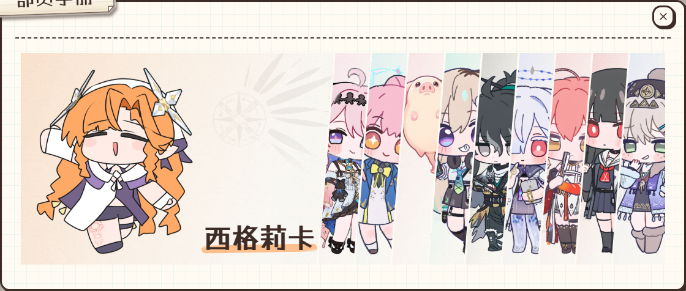

# 手册换装立绘对齐

问题：默认 Q 版使用全身高度与共同脚底线，服装却使用旧的最大 280px 头像裁切布局，造成偏上、偏小和大片底部留白。

修复：仅在桌面条带中，将已有 `PORTRAIT_VISIBLE_BOUNDS` 的非默认立绘按实际透明边界拟合到 88% 高度、95% 脚底线。忽略该展示中的共享装备缩放／偏移，避免校准再次破坏全身拟合；数据与其他使用场景保持。无已登记边界的上传资源继续原回退，吉祥物保持原布局。

57 项布局／资源优先级单元测试通过，覆盖全部登记服装资源、不同条带高度、展开前后尺寸和手机校准保留。真实 HouseModal 在 1440×768、1440×1024、390×844 检查通过，结果见 measurements.json；测试账号装备西格莉卡服装并设置非默认缩放偏移，无真实账号写入。

[桌面默认状态](./resting-1440x768.png) · [较高桌面](./resting-1440x1024.png) · [手机](./resting-390x844.png)
