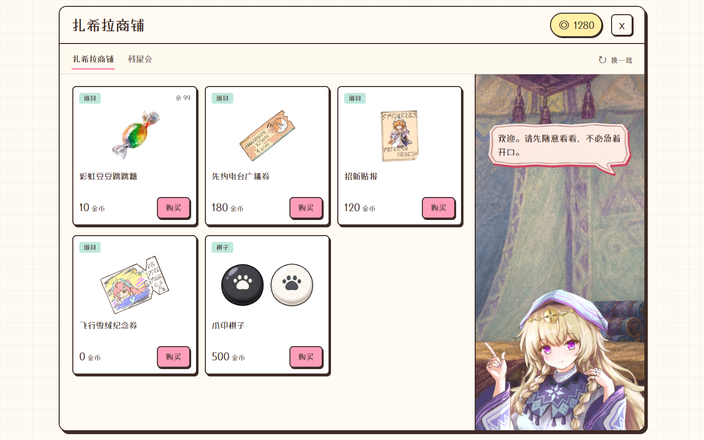
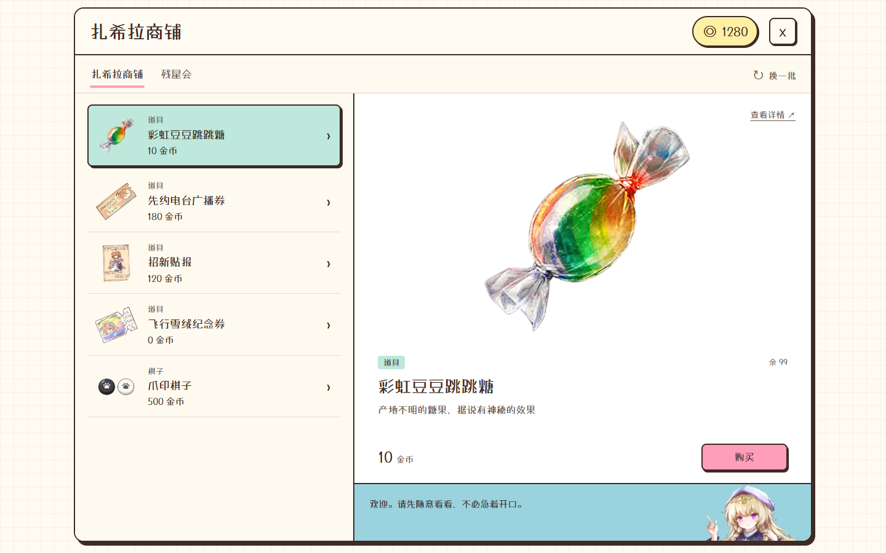
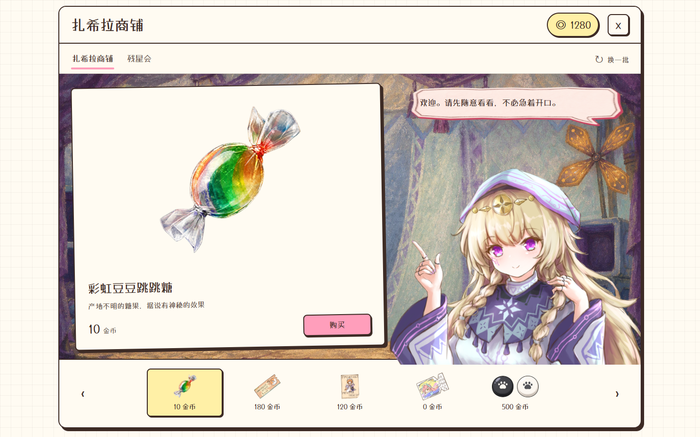

# 商店窗口审查与三套样板

本轮为独立设计探索，未接入正式商店。启动项目开发服务后，打开 `/docs/design-samples/shop-window-2026-10-23/`。顶部切换方案、桌面／390px／320px和模拟状态；预览内部支持两家商铺、商品详情、购买、刷新和关闭。

## 审查结论

最优先处理的是商品阅读与点击尺寸。现有背景、店主和手绘素材已经形成鲜明识别度，可以继续使用。

1. **P1：整卡缩放让正文和操作一起变小。** `src/modals/shop/shopLayout.js` 把五张卡放入上二下三结构；`ShopProductStage.jsx` 将布局 scale 施加到卡片外层。390×844 的真实组件搭配五件示例商品，本轮量到名义 14px 的商品名实际约 9.35px，34px 的购买按钮可见高度约 23.77px；旋转与浮动会令测量略有变化。不能仅修改 CSS 名义字号。
2. **P2：手机展示空间分配偏向场景。** 既有竖屏背景合同把上约 56% 留给商品，下约 44% 留给接待区；商品数量变多时只能继续缩小。可根据目标选择缩短店主区、采用清单，或改成单商品舞台。
3. **P2：浏览位置不稳定。** 刷新会换批次并重排位置，旋转和持续浮动也使价格不在稳定基线上。比较名称、价钱和可购买状态时需要反复扫视。
4. **P2：操作意图可以更明确。** 原刷新按钮主要靠图标和 tooltip 表达；样板直接写「换一批」。店铺入口提升为常驻标签，便于发现服装商店。
5. **P2：服装适合更大预览。** 原服装卡展示图片和价格，名称／角色／状态需进入详情。B 将选中商品长期放在大预览中，能更快判断要不要点开详情。

现状依据：`src/modals/ShopModal.jsx`、`src/modals/shop/ShopItemCard.jsx`、`src/modals/shop/CostumeCard.jsx`、`src/modals/shop/shopLayout.js`、`src/styles/mobile-adaptive/shop-window-card-layout.css`。原版截图使用现有组件与本地拦截的商品数据，不代表线上库存；[2026-10-21 字号报告](../../ui-reviews/2026-10-21-lxgw-font-size.md)也记录过同类问题，并注明此前整改已撤回。

## 三种方向

| 方案 | 布局与交互 | 优点 | 代价 |
| --- | --- | --- | --- |
| A 纸卡货架 | 桌面三列稳定卡片＋右侧接待区；手机两列滚动＋顶部店主条 | 商品名、价格和购买区整齐，购买最快，推荐作为基础方向 | 场景占比下降，手机需要滚动 |
| B 选物图鉴 | 桌面左清单、右预览；手机固定上部预览、下部清单 | 大图、名称、价格随选择更新，尤其适合服装；同一按钮位置稳定 | 每件商品先选择再购买，店主形象更小 |
| C 店主柜台 | 完整场景＋单商品展示纸，底部缩略货架 | 最接近现有逛店感，角色和商品都有视觉分量 | 同时比较多件商品较慢，需要逐件切换 |

建议：普通道具优先 A；若希望两家店有不同购买体验，可让服装商店采用 B。若游戏氛围优先于扫货效率，选 C。三版是可替换方向，未决定正式接入。

## 数据与边界

- `catalog.json` 来自已提交的 `server/adminDefaultSnapshot.js`。用 `node docs/design-samples/shop-window-2026-10-23/generate-fixtures.mjs` 重新生成。样板默认展示五件，换批次会轮换目录内容。
- 所有图像和字体直接复用项目资产。价格／说明来自默认快照，并非实时服务端数据；余额、拥有、售罄和锁定状态为明确的模拟数据。
- 购买仅更新页面内存；重复道具累计数量，服装／装饰显示已拥有。切换方案或刷新页面会重置。服装装备、真实接口失败、支付并发和服务端库存校验不在此次视觉样板范围内。
- 没有外部请求、真实购买、数据写入或生产组件覆盖；无需改动原主题 CSS。
- 三版正文和按钮不随卡片缩放。购买按钮最低 44px；手机商品名 15–16px。小分类标签为 12px，属于辅助信息。
- 原生 `dialog` 提供焦点约束与 Escape 关闭；可见焦点和 reduced-motion 分支保留。

## 视觉检查与设计钩子

场景、纸色、墨色、粉色购买区、薄荷选中态来自项目。商铺两栏间的 2px 墨色边线是布局分隔，不是卡片彩色侧条；设计检测对此的 side-tab 命中属于误报。已将商品卡／控制的 10px 和小弹窗 12px 圆角统一到设计系统的 8px／16px。比较工具栏的中性灰阶只用于样板外框，不是对正式主题的扩展。字体别名统一为 `Sigrika Window Title`，加载同一 LXGW 字体；未添加新字体。

## 验证

执行 `node docs/design-samples/shop-window-2026-10-23/verify.mjs`。默认使用 5173，可通过 `SHOP_SAMPLE_URL` 指向其它开发服务。

- 三方案 × 两商铺 × 三视口，共 18 组布局、图片加载、按钮尺寸和横向溢出检查。
- 验证手机货架末件可滚动到达；商品购买、余额变化、详情、Escape、服装已拥有、刷新冷却、关闭／重开、金币不足、售罄和两商铺空状态。
- 比较页的方案、设备和状态切换可用；无产品 API 请求和未捕获脚本错误。
- 截图和结果保存在本目录；详见 `verification.json`。这是样板级验证，不代表生产版已整改。

