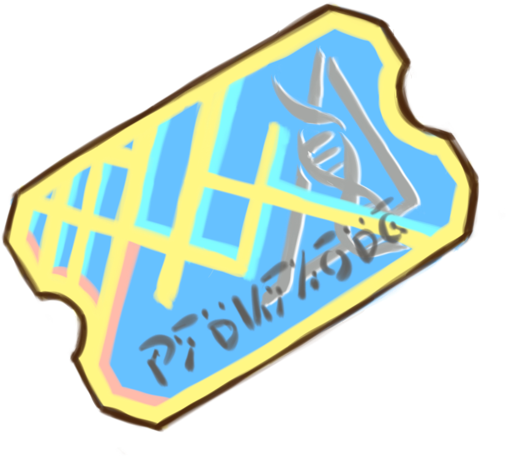

# 用户手绘星炬券

2026-10-28 按用户选定原图正式接入。此前候选稿仅为探索历史，当前运行时只使用这张蓝黄斜券。

- 原始素材：[authored-source.png](./authored-source.png)，1024×1024 RGBA。
- 裁切：左 111、上 162、宽 827、高 746；只删除完整透明行列，不重绘、旋转或缩放。
- 输出：[PNG](../../../public/assets/ui/startorch-coupon.png)、[无损 WebP](../../../public/assets/ui/startorch-coupon.webp)。两者透明度及全部可见像素均与原图相同，见 [裁切记录](./authored-crop.json)。
- `StartorchCouponIcon` 只指定宽度，图片高度自动计算，保持 827:746；正文货币词使用相同图标。
- 商店余额、价格、详情、对白和错误提示已使用券图；履历、招募、邮件附件、结算同步替换旧金币图形。内部 `coins`、奖励与价格数值不变。

## 验证

`src/shared/startorchCoupon.test.js` 核对源图非透明边界及两种输出的逐像素一致性；`StartorchCouponIcon.dom.test.jsx` 覆盖货币替换、无障碍名称、余额不足、折扣与零价购买。

浏览器使用真实 `ShopModal` 和完整生产 CSS 的本地样板，接口为内存模拟。检查桌面 1440×900、手机 390×844 与 320×568 下两家商店、服装详情和购买流程。记录见 [browser-verification.json](./browser-verification.json)，截图见 [桌面](./shop-desktop.png)、[手机](./shop-mobile.png)、[窄屏服装店](./costume-narrow.png)。

设计钩子提示的颜色字面量来自既有 `ShopModal.test.js` 与 `styleContract.test.js` 的主题断言，非本次新增配色；已检查上下文并保留原断言，不添加忽略规则。

完整检查：lint 通过；全量 466 个测试文件中的 3399 项通过，唯一失败是尚未重新生成的系统设计 HTML，执行 `npm run docs:system-design` 后文档测试 4/4 通过。资源、隔离后台快照、生产构建、构建 CSS 与生产配置校验均通过。浏览器 9 组显示检查、2 组交易流程通过，页面错误为零。
